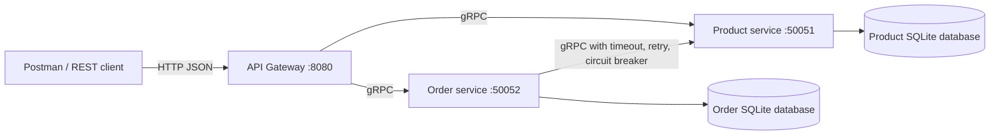

# E-commerce microservices assignment

This project implements exactly two Go microservices and one REST API gateway:

- **Product service:** owns Product data and exposes Product CRUD over gRPC.
- **Order service:** owns Order data and exposes Order CRUD over gRPC. It calls Product service over gRPC when creating, retrieving, or updating an order.
- **API gateway:** the single REST entry point. It translates HTTP/JSON requests to gRPC calls.

Each service owns a separate SQLite database. No service reads another service's database.

## Architecture



The gateway never accesses a database. Product and Order data are persisted independently.

## Project layout

```text
proto/                  Product and Order protobuf contracts and generated Go code
product-service/        Product gRPC service, repository, validation, SQLite database
order-service/          Order gRPC service, repository, validation, Product client
gateway/                REST-to-gRPC gateway
docker-compose.yml      Three application containers and two database volumes
postman_collection.json API and failure-scenario requests
REPORT_CHECKLIST.md     Suggested screenshots and captions
```

## Prerequisites

- Go 1.26 or newer
- Docker and Docker Compose
- `protoc`, `protoc-gen-go`, and `protoc-gen-go-grpc` only if protobuf contracts are changed
- Postman for manual API demonstrations

## Run with Docker Compose

```bash
cp .env.example .env
docker compose up --build
```

The gateway is available at `http://localhost:8080`.

Check gateway health:

```bash
curl -i http://localhost:8080/health
```

Stop the stack:

```bash
docker compose down
```

The database volumes are named `ecommerce-product-db` and `ecommerce-order-db`. To remove persisted data as well:

```bash
docker compose down -v
```

## Run locally without Docker

Start the Product service first:

```bash
PRODUCT_DB_PATH=products.db PRODUCT_GRPC_PORT=50051 go run ./product-service
```

In a second terminal:

```bash
ORDER_DB_PATH=orders.db \
ORDER_GRPC_PORT=50052 \
PRODUCT_SERVICE_ADDRESS=localhost:50051 \
go run ./order-service
```

In a third terminal:

```bash
GATEWAY_HTTP_PORT=8080 \
PRODUCT_SERVICE_ADDRESS=localhost:50051 \
ORDER_SERVICE_ADDRESS=localhost:50052 \
go run ./gateway
```

## Environment variables

| Variable | Default | Used by | Description |
|---|---|---|---|
| `GATEWAY_HTTP_PORT` | `8080` | Gateway | REST listening port |
| `GATEWAY_REQUEST_TIMEOUT` | `5s` | Gateway | Maximum time for a forwarded request |
| `PRODUCT_SERVICE_ADDRESS` | `localhost:50051` | Order, Gateway | Product gRPC address |
| `ORDER_SERVICE_ADDRESS` | `localhost:50052` | Gateway | Order gRPC address |
| `PRODUCT_GRPC_PORT` | `50051` | Product | Product gRPC listening port |
| `ORDER_GRPC_PORT` | `50052` | Order | Order gRPC listening port |
| `PRODUCT_DB_PATH` | `product-service.db` | Product | Product service SQLite file |
| `ORDER_DB_PATH` | `order-service.db` | Order | Order service SQLite file |
| `PRODUCT_CALL_TIMEOUT` | `2s` | Order | Per Product gRPC call deadline |
| `PRODUCT_MAX_RETRIES` | `3` | Order | Maximum retries after the first attempt |
| `PRODUCT_RETRY_BACKOFF` | `100ms` | Order | Initial exponential backoff |
| `PRODUCT_BREAKER_FAILURES` | `3` | Order | Consecutive retryable failures before opening |
| `PRODUCT_BREAKER_TIMEOUT` | `10s` | Order | Open-circuit period before half-open testing |

See [.env.example](./.env.example) for a ready-to-copy configuration.

## REST API

| Method | URL | Success | Description |
|---|---|---:|---|
| `POST` | `/products` | `201` | Create a product |
| `GET` | `/products/{id}` | `200` | Retrieve a product |
| `PUT` | `/products/{id}` | `200` | Replace product fields |
| `DELETE` | `/products/{id}` | `204` | Delete a product |
| `POST` | `/orders` | `201` | Create an order after Product validation |
| `GET` | `/orders/{id}` | `200` | Retrieve an order after Product validation |
| `PUT` | `/orders/{id}` | `200` | Update an order after Product validation |
| `DELETE` | `/orders/{id}` | `204` | Delete an order |
| `GET` | `/health` | `200` | Gateway healthcheck |

Product request body:

```json
{
  "name": "Mechanical keyboard",
  "description": "USB keyboard",
  "price": 50,
  "stock": 10
}
```

Order request body:

```json
{
  "productId": "PRODUCT_ID_FROM_CREATE",
  "quantity": 2
}
```

Product prices must be positive, stock cannot be negative, names and IDs must be non-empty, and order quantities must be positive.

## Error mapping

| gRPC status | Gateway status |
|---|---:|
| `INVALID_ARGUMENT` | `400 Bad Request` |
| `NOT_FOUND` | `404 Not Found` |
| `ALREADY_EXISTS` | `409 Conflict` |
| `UNAVAILABLE` | `503 Service Unavailable` |
| `DEADLINE_EXCEEDED` | `504 Gateway Timeout` |
| Any other error | `500 Internal Server Error` |

Errors are returned as JSON:

```json
{
  "error": "product not found"
}
```

## Resilience demonstration

The Order service wraps every Product lookup with:

1. A per-call context deadline.
2. Retries only for `UNAVAILABLE` and `DEADLINE_EXCEEDED`.
3. Exponential backoff between retry attempts.
4. A circuit breaker that opens after consecutive retryable failures.

To demonstrate the behavior:

1. Start the stack with `docker compose up --build`.
2. Create a Product and then create an Order using the Postman collection.
3. Stop Product service while the stack is still running:

   ```bash
   docker compose stop product-service
   ```

4. Send `POST /orders` with a valid product ID.
5. Watch Order logs:

   ```bash
   docker compose logs -f order-service
   ```

   The logs show retry attempts, backoff, and a circuit transition to `open`.
6. The gateway returns `503` instead of hanging.
7. Restart Product service:

   ```bash
   docker compose start product-service
   ```

8. After the breaker timeout, send another valid order request. The breaker permits a half-open test request and logs a transition back to `closed` after a successful Product response.

## Protobuf generation

Regenerate Go code after changing either `.proto` file:

```bash
make proto
```

The command uses `protoc` with the Go and Go gRPC plugins.

## Tests

Run all tests:

```bash
go test ./...
```

The tests cover Product and Order CRUD, validation, Product dependency calls, retry filtering, circuit opening, gateway routing, and gRPC-to-HTTP status mapping.

## Postman

Import [postman_collection.json](./postman_collection.json) into Postman. Set the collection variable `baseUrl` to `http://localhost:8080` if your gateway uses a different address. Run the Product CRUD folder before the Order CRUD folder so the collection can reuse the created product and order IDs.
